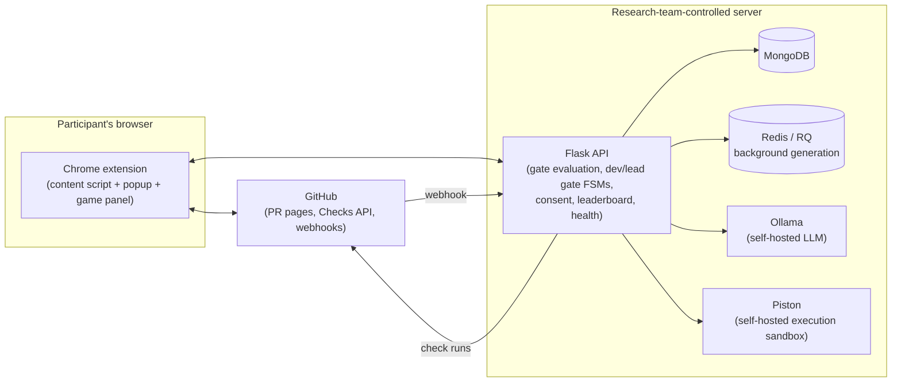

<p align="center">
  
</p>

# AICodeQuest-Industry

A comprehension gate for AI-generated code: a Chrome extension that sits
on GitHub PR pages and requires a developer (and, separately, a lead
reviewer) to demonstrate they understand an AI-authored change before a
merge proceeds — backed by a Flask API that perturbs the changed code,
grades the developer's fixes, generates diff-grounded multiple-choice NFR
questions for the lead, and reports pass/fail back to GitHub via the
Checks API.

## How a gate is played

1. A developer opens a pull request. The extension asks which hunks were
   AI-authored — an explicit self-tag, recorded as a study measure, never
   inferred. On a 52-file pull request that is a dropout wall, so a file
   with more than one hunk offers **per-file** "all mine" / "all AI"
   buttons — per file, never whole-diff, because a file is the unit people
   actually remember authoring and a single whole-diff button is what
   somebody clicks to dismiss a dialog. The risk is made visible rather
   than absent: every answer records `tagging_method` (`per_hunk`,
   `per_file`, `mixed`, `none`), so an analysis can ask whether
   bulk-tagged pull requests behave differently. `"unknown"` means the
   answer predates the field, never a default.
2. `POST /gate/evaluate` decides whether the gate fires, from the changed
   surface and the modules touched. A cosmetic re-push of code already
   cleared is skipped automatically.

   The extension fetches each changed file **whole**, at the pull
   request's head commit, rather than working from the diff. A unified
   diff carries only *hunks* for a modified file, so stitching them
   together produces disjoint fragments with no `def` in them — measured
   on a 12-file change, that yielded **0 extractable functions**, a gate
   that fired with nothing to play. Fetching whole files gave **24**. If
   the fetch fails the gate still starts on the reconstructed text, and
   `source_is_whole_file` records which one each file got.
3. If it fires, the Create/Merge button is disabled (**cosmetically** — see
   below) and a red icon opens the panel.
4. **Developer gate:** one round of turns against the participant's own
   code — 8 Defense, then 5 comprehension questions, then 4 Attack. Turns
   are interleaved across the changed files, so a large first file cannot
   swallow the whole round.
   *Defense* — a bug has been planted in one of their functions; find it
   and fix it. The bug is drawn from a 40-operator catalogue
   (`config/params.yaml`'s `bug_bank`, 10 per difficulty level) and is
   **proved to be a real bug before it is shown**: a test suite generated
   from the participant's ORIGINAL code must pass on it and fail on the
   planted version, or the bug is thrown away and regenerated. The suite's
   expected values are never asked of the model — they are captured by
   *executing* the original function — and since Phase 32 the function is
   compiled **inside its own file**, so a class member (which has no
   meaning torn out of its class) can be graded by tests at all.

   Not every function can be graded that way, and since Phase 33 that is
   decided **statically and up front** rather than by spending a model call
   and a sandbox run to find out. A React handler nested inside its
   component closes over state that will not exist when it is called from a
   fresh entry point, and a JSX body cannot execute in a sandbox with no
   npm packages at all; such a function goes straight to **comparison
   grading** — the designed bottom rung, where the fix is compared against
   the known original. Measured on a real 762-line React pull request: the
   same verdict that used to cost 40-100 seconds per function now takes
   23 ms for the whole pool. `testgen.suite_eligibility_precheck: false`
   restores the older always-try behaviour.

   **Languages** are a config table (`config/params.yaml`'s `languages`),
   not a hardcoded list, and each says whether it is graded by tests or by
   comparison: python, javascript, java, c, cpp and rust are
   test-graded; **typescript** (`.ts`/`.tsx`), html and css are
   comparison-graded — for TypeScript that is a fact about the sandbox
   rather than a preference, since Piston has no TypeScript runtime
   installed. A comparison-graded language plays the gate normally,
   perturbation and repair and all, just without executable suites.
   `.vue` and `.svelte` are still unsupported, and an unsupported
   language is worse than it sounds: the trigger counts lines regardless
   of language, so such a pull request fires the gate, disables
   Create/Merge, and then has nothing to play.

   *Attack* — plant a bug of their own and see whether an AI opponent can
   fix it (optional; skipping costs nothing). Four attack turns against
   defence's eight: attack forms a hypothesis about bug-planting, defence
   carries the comprehension claim.

   *Comprehension* — five input/output prediction questions over the
   functions they just worked on, shown with the code. Every one must be
   **answered** before the pull request can be raised; none of them is
   **scored**, and the screen says so. Requiring an answer is what makes
   the data point exist; not scoring it is what stops it becoming
   something to play rather than answer.

   Fail the round and it replays with bugs they have not seen.
5. **Lead gate:** one diff-grounded **multiple-choice** question per
   selected non-functional requirement, graded against an answer key
   committed when the question was generated. After answering — and only
   after, so the key is not given away — the lead is invited to say
   whether that question and its marked-correct option were actually
   valid. **The lead is the study's human verifier of LLM-generated
   assessment content**, which is what makes "was the generator sound?" a
   reported number rather than an assumption. The form is optional and
   flagging an item never changes the lead's own score.
6. Clearing re-enables the button and updates the participant's standing
   on that persona's leaderboard — there are two, ranked on different
   metrics, because catching a planted bug and reading a change for its
   non-functional consequences are not the same skill.
7. Any time after that, the participant can download a **progress report**
   (.docx, with charts) showing which bug classes they catch and which get
   past them — from the panel's *Your Progress* screen or the popup.

**Enforcement, stated plainly:** disabling the button in the page is
cosmetic — GitHub's own JavaScript, a keyboard shortcut or a direct API
call can still submit it. Real merge protection comes from the GitHub
Checks API plus branch protection on the repository, which this app can
neither configure nor verify (`docs/BRANCH-PROTECTION-SETUP.md` lists the
bypass paths that remain even when it is set up correctly).

## Architecture



No participant code leaves this self-hosted infrastructure — see
`docs/DATA-FLOW.md` for the full third-party exposure map.

For the whole picture — both state machines, the data model, how
generated content is quality-checked, the extension's isolated-world
constraints, and the known gaps — read **`docs/ARCHITECTURE.md`**
(`docs/ARCHITECTURE.docx` is generated from it via
`make architecture-doc`).

## Quickstart (local dev)

Requires Python 3.13+, Node.js, and Docker.

```bash
git clone <this-repo>
cd AICodeQuest-Industry

make venv        # creates .venv/, installs backend/requirements-dev.txt
make up          # Mongo, Redis, the RQ worker, self-hosted Piston
make test        # backend test suite (689 pass, 7 skip, ~2.7 min)

cd extension
npm install
npm run build     # produces extension/dist/ -- load unpacked in chrome://extensions
npm run test:unit
npm run shots     # screenshots every panel screen from the built bundle
```

`npm run build` reads `config/params.yaml` directly: it inlines
`extension.backend_base_url` (currently
`https://your-backend.example.com`, an ngrok tunnel
fronting the study host's port 5055) into the service worker and computes
`manifest.json`'s `host_permissions` from it.
There is no runtime config fetch, so **after changing that URL you must
re-run `npm run build` and press Reload on the extension in
`chrome://extensions`** — the build prints the URL it used, so check that
line if the extension is talking to the wrong backend.

If you are updating an existing checkout, re-run `make venv` (or
`pip install -r backend/requirements.txt`) — the progress report added
`python-docx` and `matplotlib`, and `GET /leaderboard/report.docx` returns
500 without them.

A local Ollama server (`qwen2.5:7b-instruct` generator, `mistral:latest`
opponent) must be reachable at `http://localhost:11434` for anything that
calls the LLM layer for real — tests use `MockLLM`/`ScriptedLLM` instead
and don't need it.

To exercise the extension against the real backend, see
`backend/scripts/run_dev_server.py`'s own docstring. For a real single-VM
study deployment (TLS, backups, no dev shortcuts), see
`docs/DEPLOYMENT.md`.

### Things that will bite you locally

- **Dev Redis is on host port `16379`, not 6379** (a real port collision on
  the shared lab machine — see `reports/phase-13-review.md`). `make test`
  sets `REDIS_URL` to database 7 for you; if you run `pytest` by hand,
  do the same, or the dev worker container steals the tests' RQ jobs and
  about eleven fail for reasons unrelated to your change.
- **The backend is on port `5055`, not Flask's default 5000** — an
  unrelated project on the lab machine already holds `0.0.0.0:5000`, and
  the failure mode is worse than a bind error: whichever process wins the
  port is what the extension ends up talking to. The port is defined once,
  as part of `config/params.yaml`'s `extension.backend_base_url`; both dev
  servers parse it back out of that URL, so never hardcode it anywhere.
  Change it there, then rebuild the extension.
- **That URL is currently a public ngrok tunnel, not `localhost`** (the
  backend is on the Linux box, Chrome is on a separate desktop). It has
  no port in it on purpose: the dev servers fall back to 5055 when the
  URL names no port, which is the local port the tunnel forwards to. A
  free ngrok tunnel also serves an HTML interstitial with HTTP **200** to
  any browser User-Agent, which is what every extension fetch looks like
  — `extension/src/shared/api.js` sends `ngrok-skip-browser-warning` on
  every backend request for that reason. The tunnel URL changes whenever
  ngrok is restarted without a reserved domain; when it does, edit config
  and rebuild the extension.
- **`docker compose up -d` does not recreate an already-running
  container.** After changing `infra/docker-compose.yml`'s environment,
  use `--force-recreate` (`make up` does this for the worker). A worker
  left running for days on an old definition — no `OLLAMA_BASE_URL`, so
  every generation job died — was the single largest cause of slow turns.
- **The RQ worker must be running, AND restarted after backend changes.**
  Without it nothing consumes the `generation` queue and every turn is
  generated inline. Worse, a worker running *stale* code still consumes
  the queue, so the foreground waits out the full 45s budget for jobs it
  fails — run `make worker-restart` after editing anything in
  `backend/app/`.
- **`localhost` is not the same machine everywhere.** Mongo, Redis and
  Ollama run on the server; if you inspect the database from a different
  desktop with Compass, point it at the server's address, not `localhost`.
- **Nothing is recorded until a participant exists and has consented.**
  Register from the extension popup, then give consent there — both gates
  hard-403 without a consent record.
- **There are two consents and only one of them is the participant's.**
  *Participant* consent is signed by the person, in the popup, and covers
  what the study may keep about them. *Organisation* consent is asserted
  by a **researcher**, per repository **owner**, and covers whether the
  study may run on that owner's code at all — it has no UI, and signing
  the first can never satisfy the second. This has cost real testing time
  three times, presenting as `org_consent_missing` right after a
  participant consented. `consent.org_consent_mode` now defaults to
  **`advisory`**: the gate proceeds without a record and *records that it
  did* (`org_consent_absent`, plus `org_consent_present: false` on the
  evaluation), so no session is ever silently unattributable. Grant a real
  record with `backend/scripts/register_org_consent.py` (`--list` shows
  what is covered; `--org '*'` is a wildcard; `--agreement-ref` is
  required with no default, because running it *asserts* an organisation
  agreed). **Set `org_consent_mode: required` before real participants.**


## Study data

Everything lives in MongoDB. Two consolidated collections answer "what
happened to this participant on this pull request?" without a join:

- **`developer_records`** — session, every turn with the perturbation the
  participant was actually shown, a summary, and every gate evaluation
  (including the self-tagged authorship ranges)
- **`lead_records`** — the same shape for the Lead gate: NFRs chosen, each
  multiple-choice question with its QC verdict, each answer, and each
  human verification (nothing here is scored by an LLM judge — that was
  removed in Phase 30 along with the free-text scorer)

Both are *maintained projections*: the gate FSMs' own collections remain
the source of truth (they carry the unique indexes the concurrency safety
depends on), and `backend/scripts/rebuild_records.py` recomputes the
projections from them at any time.

Three ways data comes back out, for three different readers:

| | |
| --- | --- |
| `GET /leaderboard/export` | the participant's own full JSON dump — the right shape for a data request |
| `GET /leaderboard/report.docx` | the same data as a readable report with charts — the right shape for a person (`services/report_docx.py`) |
| `backend/scripts/export_study_data.py` | the anonymised research export — pseudonymous IDs via a salted hash, with the real user id only in a separate private mapping file |
| `backend/scripts/mcq_agreement.py` | the comprehension-item analysis — per-rater accuracy against the executed key and chance-corrected agreement, as CSV + JSON + codebook (`GET /research/mcq-agreement` serves the same thing) |

## License

MIT — see `LICENSE`.
